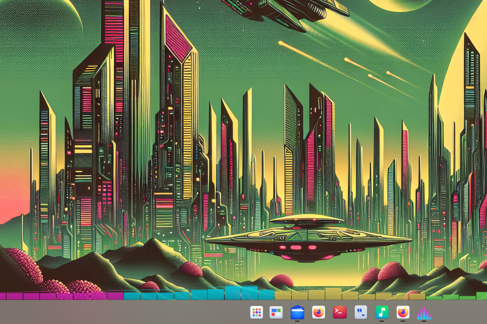
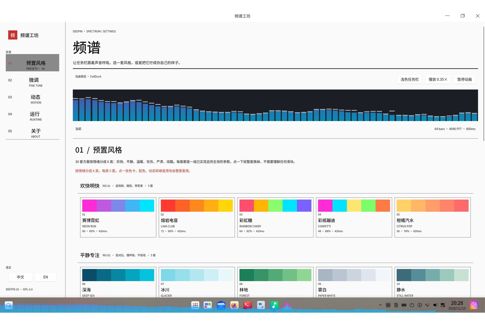
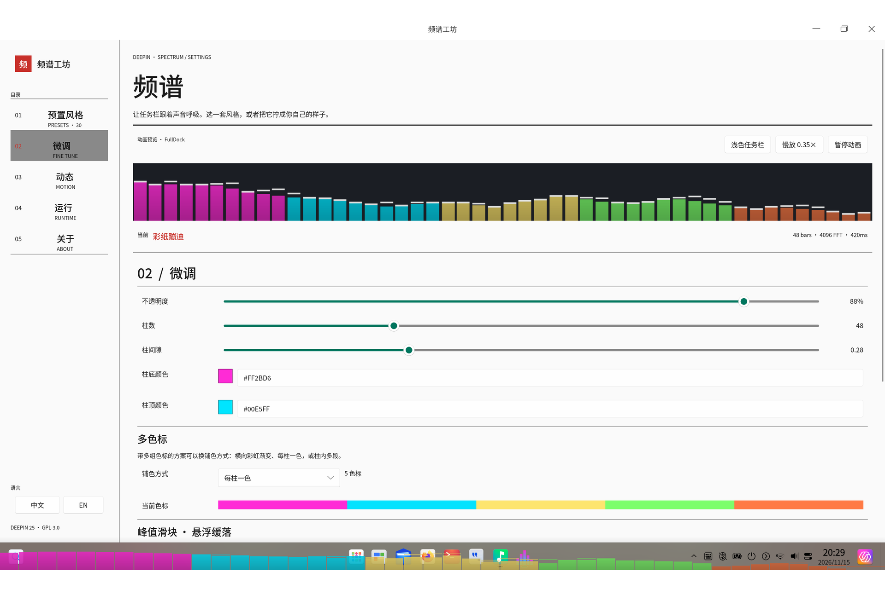
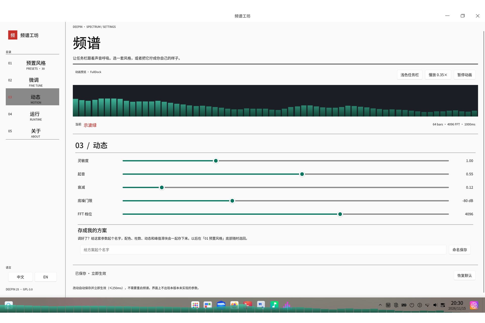
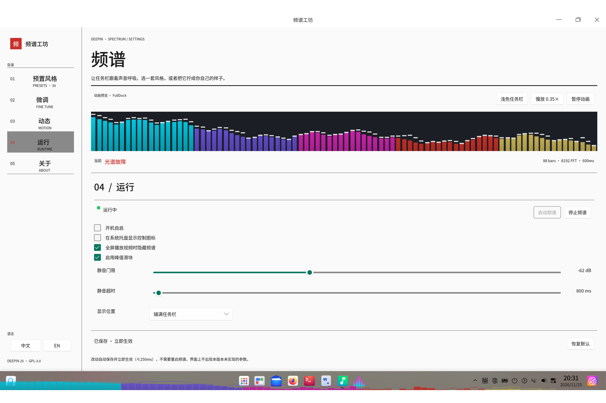
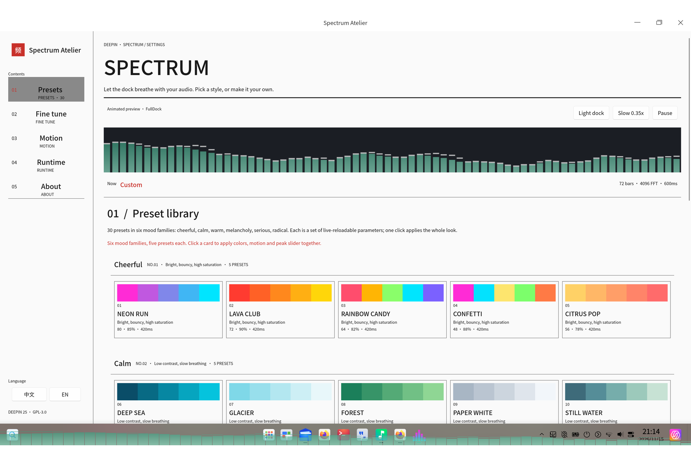

# deepin Taskbar Audio Spectrum (Spectrum Atelier)

**English** · [简体中文](README.md)


A live audio spectrum rendered on the Deepin 25 taskbar, working on both
Treeland/Wayland and X11. It runs as a standalone daemon that taps the
PulseAudio/PipeWire monitor stream directly — no dde-shell patches, no extra
sink, and no changes to the default output.



## Features

- **Driven by real audio**: reads the monitor of the default output, so bars react to whatever is playing.
- **30 built-in presets**: grouped into six moods (cheerful, calm, warm, melancholy, serious, cool); one click applies and hot-reloads.
- **Multi-stop gradients**: 3–8 color stops with across, per-bar, or vertical layouts.
- **Floating peak caps**: caps are kicked up, hover, then fall back slowly; toggle and speed are configurable.
- **Two placements**: fill the taskbar, or float above it; follows taskbar height changes.
- **Chinese and English UI**: switch instantly, persisted across launches; light/dark theme follows the system.
- **Optional system tray**: hidden by default so no second app-menu entry appears; enable it in settings.
- **Built to stay running**: single-instance guard, automatic reconnect after audio service restarts, FFT skipped while silent.
- **Zero external dependencies by default**: the main binary builds offline; `doctor` reports compiled capabilities and runtime environment.

## Screenshots

| Preset library | Fine tuning |
|---|---|
|  |  |

| Motion and custom presets | Runtime and placement |
|---|---|
|  |  |

English UI:



## Requirements

- Deepin 25 with a Treeland/Wayland or X11 session
- PulseAudio or PipeWire (reads the monitor stream of the default output)
- The current release provides an `amd64` package; for other architectures run `scripts/build-deb.sh` on that machine

### Which of the two packages?

Each release ships two `amd64` packages:

| System | Package | Notes |
|---|---|---|
| deepin 25 (glibc ≥ 2.29) | `deepin-spectrum_<version>_amd64.deb` | built natively on deepin 25 |
| UOS 20 / Debian 10 (glibc 2.28) | `deepin-spectrum_<version>_amd64_uos20.deb` | built in a glibc 2.28 container; highest symbol is `GLIBC_2.28` |

One package cannot serve both: binaries built on deepin 25 reference `GLIBC_2.29 ~ GLIBC_2.34`,
while UOS 20 only has glibc 2.28 and fails with `version 'GLIBC_2.34' not found`. glibc is not
backward compatible in that direction, so the package must be rebuilt against the oldest target glibc.

Build the UOS 20 package yourself:

```bash
bash scripts/build-deb-uos20.sh
```

It compiles and packages inside a Debian 10 container (glibc 2.28, same base as UOS 20), writes
`dist/uos20/deepin-spectrum_<version>_amd64_uos20.deb`, and verifies the highest required symbol is
`GLIBC_2.28`. Requires podman and the project's offline toolchain (`.dev-env/`).

## Install

Download the `.deb` matching your system from [Releases](../../releases):

```bash
# deepin 25
sudo apt install ./deepin-spectrum_0.5.10_amd64.deb

# UOS 20 / Debian 10
sudo apt install ./deepin-spectrum_0.5.10_amd64_uos20.deb
```

Then open "Spectrum Atelier" from the app menu, or run:

```bash
deepin-spectrum-settings
```

Check the background service:

```bash
systemctl --user status deepin-spectrum
```

> Autostart is off by default. Enable it in the settings window to create the
> systemd user unit symlink.

### Upgrading

`apt install` / `dpkg -i` only replaces the executable on disk. The **running
daemon keeps executing the old code**, so the visuals will not change right
after an upgrade — that is expected and does not mean the fix failed. Restart
the service to load the new build:

```bash
# If autostart (the systemd user unit) is enabled
systemctl --user restart deepin-spectrum
```

Quitting and relaunching from the tray icon works too, as does a reboot.

## Usage

### Settings window

A magazine-style layout: a numbered index switches between four sections, and
the first screen shows 30 preset cards. Clicking one writes the config and
applies it immediately. A simulated 5 fps animation preview at the top can be
paused or slowed down to inspect the peak-cap behavior.

### Command line

| Command | Description |
|---|---|
| `deepin-spectrum daemon --live` | capture → FFT → render → overlay |
| `deepin-spectrum daemon --synthetic 440 --duration 10` | self-test without audio (440 Hz tone) |
| `deepin-spectrum doctor [--json]` | compiled features, FFT backend, config warnings, taskbar geometry |
| `deepin-spectrum tray` | start the tray controller |
| `deepin-spectrum settings --list-presets` | list built-in presets and custom presets |
| `deepin-spectrum settings --apply-preset neon-run` | apply a preset |
| `deepin-spectrum settings --save-preset "late night"` | save the current config as a named preset |
| `deepin-spectrum settings --delete-preset <id>` | delete a custom preset |

### Custom presets

Use the save control at the bottom of the "02 Fine tune" and "03 Motion"
sections. One save stores appearance, motion, peak caps, and multi-stop colors
(16 values in total). Presets live in `~/.config/deepin-spectrum/presets/`,
one TOML file each; saving under the same name updates it without touching the
main config.

### Multi-stop colors

Put 3–8 `#RRGGBB` stops in `visual.palette` and pick a layout with
`visual.palette_mode`:

| Mode | Result |
|---|---|
| `off` (default) | the original `color_start → color_end` gradient |
| `across` | stops spread smoothly from left to right |
| `per_bar` | one color per bar |
| `vertical` | stops stacked from bottom to top inside each bar |

## Build

Requires Rust 1.92. The default main build has no external dependencies and can
compile offline.

```bash
# main binary with all features (X11 / Wayland / Pulse / tray / realfft)
cargo build --release --features dbus,x11,pulse,tray,wayland,fft-realfft

# settings UI (separate workspace)
(cd crates/spectrum-settings-gui && cargo build --release)
```

An isolated offline toolchain is available:

```bash
source scripts/activate-dev-env.sh
python scripts/check_dev_env.py
```

## Packaging

```bash
bash scripts/build-deb.sh
```

Artifacts are written to `dist/`:

- `deepin-spectrum_<version>_<arch>.deb`
- matching `.sha256`
- structured evidence in `docs/spike-deb.json`

The version is read from `Cargo.toml`; packaging aborts if the GUI crate or
`debian/changelog` disagree. Twelve assertions run after assembly, including a
`doctor` check of compiled features and the package file list.

## Quality gates

```bash
cargo test --workspace
cargo test --workspace --all-features
cargo clippy --workspace --all-features --all-targets -- -D warnings
cargo fmt --all --check
RUSTDOCFLAGS="-D warnings" cargo doc --workspace --no-deps --all-features
(cd crates/spectrum-settings-gui && cargo test && cargo clippy --all-targets -- -D warnings)
```

Or run `bash scripts/ci.sh`, which covers the default, all-features, feature
subset, and GUI builds.

## Configuration

| Path | Contents |
|---|---|
| `~/.config/deepin-spectrum/config.toml` | main config, hot-reloads in about 250 ms |
| `~/.config/deepin-spectrum/presets/*.toml` | custom presets, one file each |
| `~/.config/deepin-spectrum/ui.toml` | UI state such as language |

## Known limitations

- `advanced.x11_stacking=managed-below` is not implemented; it warns and falls back to `override-redirect`.
- `visual.rounded` / `visual.blend` are not implemented; `peak_cap` is implemented and configurable.
- The animation preview uses simulated frames with the same physics as the renderer, not live audio levels.
- Primary monitor only; multi-monitor placement is not implemented.
- Native Wayland fullscreen detection relies on `zwlr_foreign_toplevel_manager_v1`; it falls back to XWayland EWMH detection when unavailable.
- The settings UI uses Slint 1.18 (GPL-3.0-only), so the project as a whole is distributed under GPL-3.0-only.

## License

**GPL-3.0-only** (not "or later"). See [LICENSE](LICENSE) and `debian/copyright`.

Slint 1.18.1, used by the settings UI, is licensed under
`GPL-3.0-only OR LicenseRef-Slint-Royalty-free-2.0 OR ...` and forbids declaring
binaries that link it as "or later". That is why the whole project is
GPL-3.0-only. Switching to GPL-3.0-or-later would require replacing Slint first.

## Author

**Feelup** · testangel@163.com
