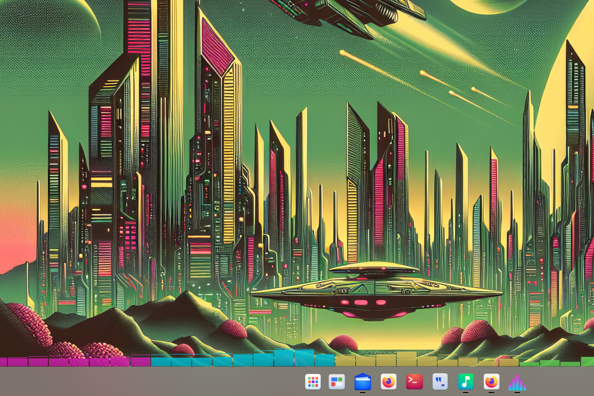
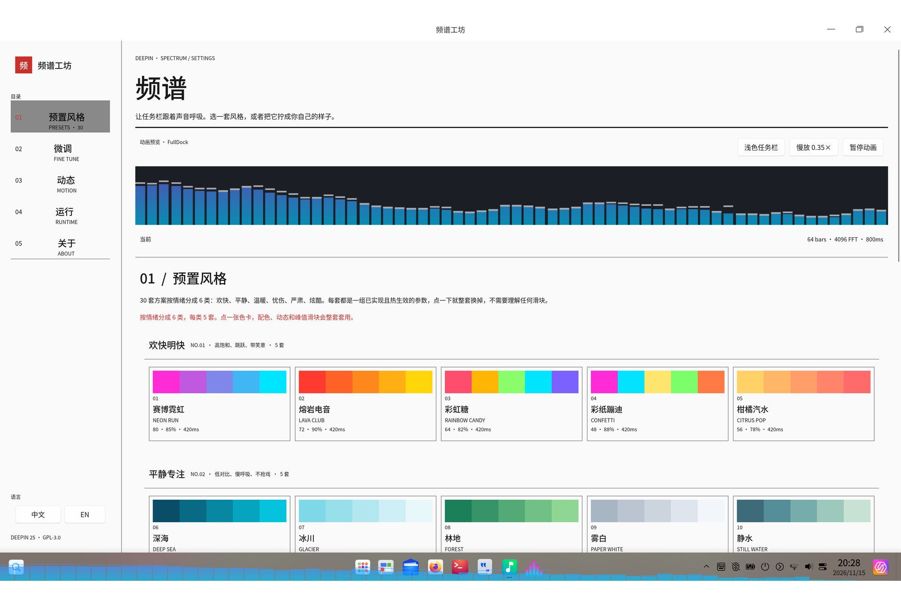
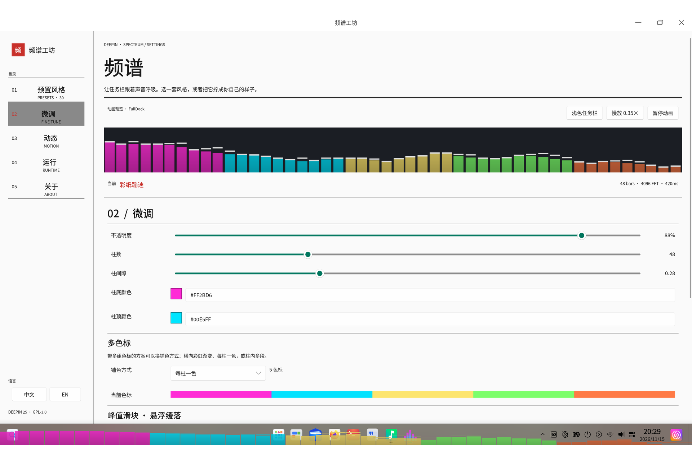
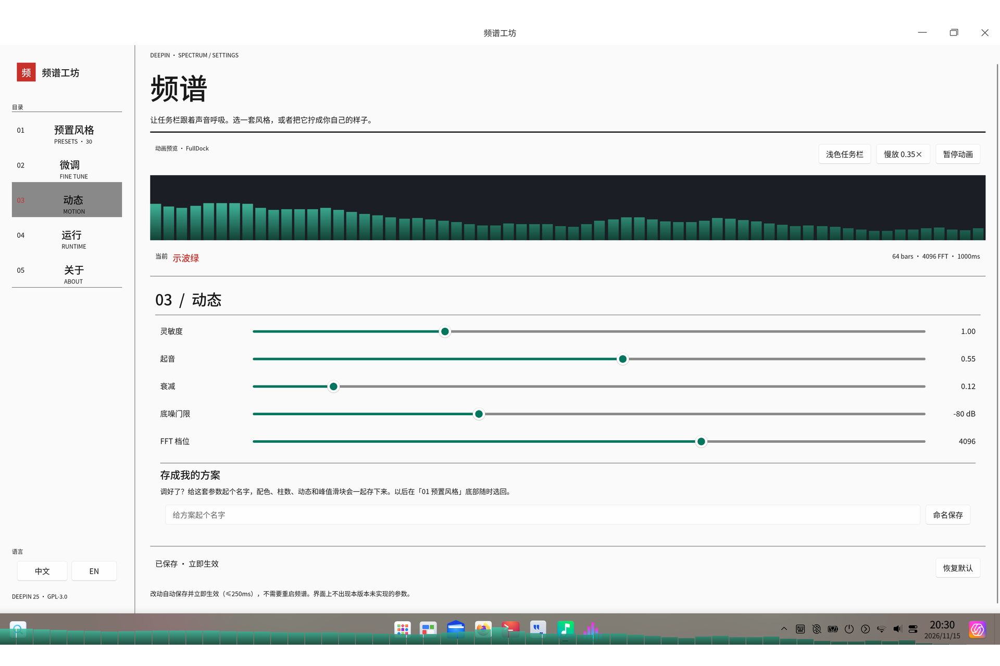
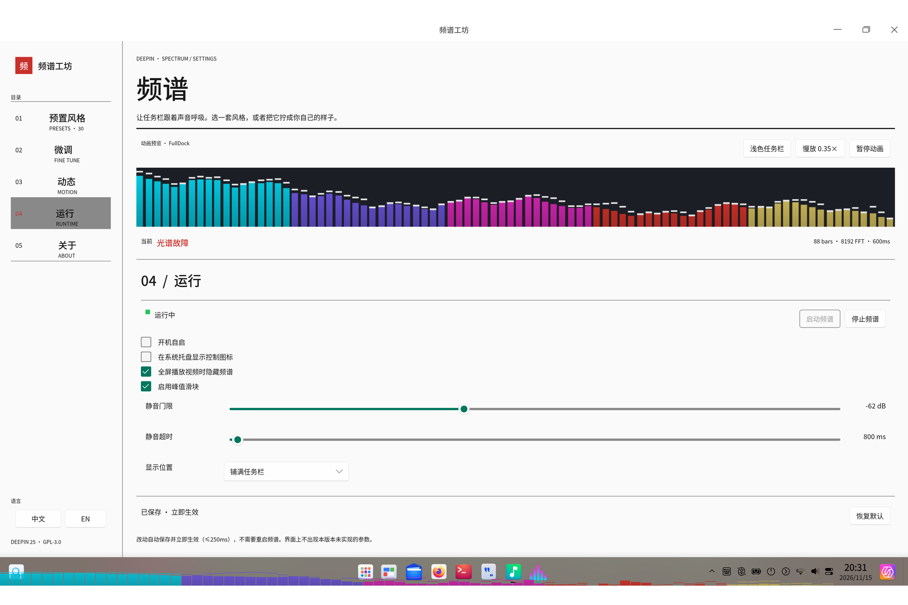
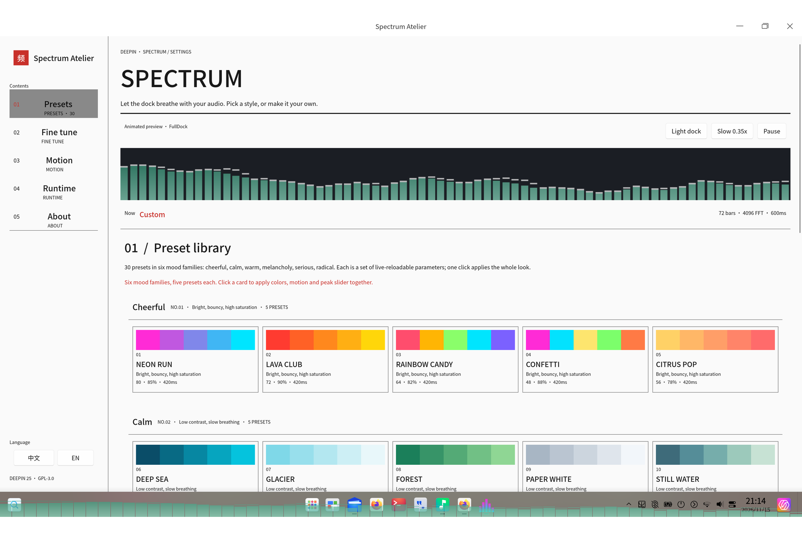

# deepin 任务栏音频频谱插件（频谱工坊）

[English](README.en.md) · **简体中文**


在 Deepin 25（Treeland/Wayland 或 X11）任务栏上显示系统混音的实时频谱柱。
独立常驻进程，直接读取 PulseAudio/PipeWire monitor，不修改 dde-shell 源码、
不新建 sink、不改默认输出。



## 特性

- **真实混音驱动**：直接采集默认输出的 monitor 流，播放什么就跳什么。
- **30 套预置色卡**：按欢快 / 平静 / 温暖 / 忧伤 / 严肃 / 炫酷 6 类情绪分区，一键写盘并热生效。
- **多色标渐变**：3~8 个色标，支持横向铺开、一柱一色、柱内纵向渐变。
- **峰值滑块 · 悬浮缓落**：柱顶滑块被顶飞、悬停、再缓慢回落，开关与速度均可调。
- **两种显示位置**：铺满任务栏，或悬浮在任务栏上方；任务栏高度变化自动跟随。
- **中英双语界面**：即时切换并持久化，深浅主题跟随系统。
- **可选系统托盘**：默认不显示，避免应用菜单出现第二个入口，可在设置中开启。
- **稳定运行**：单实例保护、音频服务重启后自动重连、静音时跳过 FFT。
- **零外部依赖构建**：主程序默认特性可离线编译；`doctor` 可自检编译能力与运行环境。

## 截图

| 预置风格库 | 微调 |
|---|---|
|  |  |

| 动态与我的方案 | 运行时与显示位置 |
|---|---|
|  |  |

英文界面：



## 运行要求

- Deepin 25，会话为 Treeland/Wayland 或 X11
- PulseAudio 或 PipeWire（读取默认输出的 monitor 流）
- 当前 Release 提供 `amd64` 包；其他架构可在对应机器上执行 `scripts/build-deb.sh` 自行构建

### 两个安装包怎么选

Release 同时提供两个 `amd64` 包，按系统选择：

| 系统 | 安装包 | 说明 |
|---|---|---|
| deepin 25（glibc ≥ 2.34） | `deepin-spectrum_<版本>_amd64.deb` | 在 deepin 25 上原生编译，符号上限 `GLIBC_2.34` |
| UOS 20 / Debian 10（glibc 2.28） | `deepin-spectrum_<版本>_amd64_uos20.deb` | 在 glibc 2.28 容器中编译，符号上限 `GLIBC_2.28` |

不能共用一个包：deepin 25 编译出的二进制带 `GLIBC_2.29 ~ GLIBC_2.34` 符号，
而 UOS 20 的 glibc 只有 2.28，运行时报 `version 'GLIBC_2.34' not found`。
二进制无法向下兼容老 glibc，只能按目标系统的最低 glibc 重新编译。

自行构建 UOS 20 兼容包：

```bash
bash scripts/build-deb-uos20.sh
```

脚本会在 Debian 10 容器（glibc 2.28，与 UOS 20 同源）里重新编译并打包，
产物为 `dist/uos20/deepin-spectrum_<版本>_amd64_uos20.deb`，并自动校验符号上限不超过 `GLIBC_2.28`。
需要 podman 和项目已有的离线工具链（`.dev-env/`）。

## 安装

从 [Releases](../../releases) 下载对应系统的 deb 包：

```bash
# deepin 25
sudo apt install ./deepin-spectrum_0.5.10_amd64.deb

# UOS 20 / Debian 10
sudo apt install ./deepin-spectrum_0.5.10_amd64_uos20.deb
```

安装后从应用菜单打开「频谱工坊」（英文名 Spectrum Atelier），或直接运行：

```bash
deepin-spectrum-settings
```

检查后台服务：

```bash
systemctl --user status deepin-spectrum
```

> 开机自启默认关闭，需要在设置界面勾选后才会创建 systemd 用户单元的 enable 链接。

### 升级到新版本

`apt install` / `dpkg -i` 只替换磁盘上的可执行文件，**正在运行的后台进程仍在执行旧代码**，
所以升级后画面不会立刻变化——这是正常现象，不代表修复未生效。请重启频谱让它加载新版本：

```bash
# 若已开启开机自启（存在 systemd 用户单元）
systemctl --user restart deepin-spectrum
```

也可以从托盘图标退出后重新启动，或重启系统。

## 使用

### 设置界面

采用杂志排版：左侧编号目录切换 4 个分区，首屏是 30 张预置色卡，点一张即写盘并热生效。
顶部带一段模拟动画预览（5fps，可暂停 / 慢放），用于观察峰值滑块效果。

### 命令行

| 命令 | 说明 |
|---|---|
| `deepin-spectrum daemon --live` | 采集 → FFT → 渲染 → 叠加窗上屏 |
| `deepin-spectrum daemon --synthetic 440 --duration 10` | 无声环境自检（合成 440Hz） |
| `deepin-spectrum doctor [--json]` | 编译能力、FFT 后端、配置告警、任务栏几何 |
| `deepin-spectrum tray` | 启动托盘遥控器 |
| `deepin-spectrum settings --list-presets` | 列出内置预置与我的方案 |
| `deepin-spectrum settings --apply-preset neon-run` | 应用一套预置 |
| `deepin-spectrum settings --save-preset "深夜写代码"` | 把当前配置命名保存 |
| `deepin-spectrum settings --delete-preset <id>` | 删除「我的方案」 |

### 我的方案

「02 微调」和「03 动态」页底部可直接命名保存，一次保存外观 + 动态 + 峰值滑块 + 多色标共 16 个值。
方案存放在 `~/.config/deepin-spectrum/presets/`，每个方案一个 TOML 文件，同名保存会更新，不影响主配置。

### 多色标

在 `visual.palette` 中填写 3~8 个 `#RRGGBB` 色标，并用 `visual.palette_mode` 选择铺法：

| 模式 | 观感 |
|---|---|
| `off`（默认） | 沿用 `color_start → color_end` 双色渐变 |
| `across` | 色标沿整条频谱从左到右平滑铺开 |
| `per_bar` | 一根柱一个颜色 |
| `vertical` | 柱内从下到上跨多段色标 |

## 构建

依赖 Rust 1.92；主程序默认构建零外部依赖，可离线编译。

```bash
# 主程序 + 全部 feature（X11 / Wayland / Pulse / 托盘 / realfft）
cargo build --release --features dbus,x11,pulse,tray,wayland,fft-realfft

# 设置界面（独立 workspace）
(cd crates/spectrum-settings-gui && cargo build --release)
```

项目可选使用自带的离线工具链：

```bash
source scripts/activate-dev-env.sh
python scripts/check_dev_env.py
```

## 打包

```bash
bash scripts/build-deb.sh
```

产物在 `dist/`：

- `deepin-spectrum_<版本>_<架构>.deb`
- 同名 `.sha256`
- 结构化证据 `docs/spike-deb.json`

版本取自 `Cargo.toml`，打包前会校验 GUI crate 与 `debian/changelog` 三处一致，不一致直接中止。
组包后会执行 12 项断言，含 `doctor` 逐项核对已编译 feature 与关键文件清单。

## 质量门

```bash
cargo test --workspace
cargo test --workspace --all-features
cargo clippy --workspace --all-features --all-targets -- -D warnings
cargo fmt --all --check
RUSTDOCFLAGS="-D warnings" cargo doc --workspace --no-deps --all-features
(cd crates/spectrum-settings-gui && cargo test && cargo clippy --all-targets -- -D warnings)
```

也可直接运行 `bash scripts/ci.sh`（默认、all-features、feature 子集、GUI 全跑）。

## 配置

| 路径 | 内容 |
|---|---|
| `~/.config/deepin-spectrum/config.toml` | 主配置，修改后约 250ms 热生效 |
| `~/.config/deepin-spectrum/presets/*.toml` | 「我的方案」，一个方案一个文件 |
| `~/.config/deepin-spectrum/ui.toml` | 界面语言等 UI 状态 |

## 已知限制

- `advanced.x11_stacking=managed-below` 未实现：配置会告警并降级为 `override-redirect`。
- `visual.rounded` / `visual.blend` 未实现；`peak_cap` 已实现并在设置界面可开关。
- 动画预览是模拟帧（与内核同构的物理），不接真实音频电平。
- 仅主屏显示，多屏策略尚未接入。
- Wayland 原生全屏检测依赖 `zwlr_foreign_toplevel_manager_v1`；合成器未导出该协议时退回 XWayland EWMH 检测。
- 设置界面使用 Slint 1.18（GPL-3.0-only），因此整体按 GPL-3.0-only 分发。

## 许可证

**GPL-3.0-only**（不是 "or later"）。详见 [LICENSE](LICENSE) 与 `debian/copyright`。

设置界面依赖的 Slint 1.18.1 采用 `GPL-3.0-only OR LicenseRef-Slint-Royalty-free-2.0 OR ...`，
且禁止把链接它的产物声明为 "or later"，因此本项目整体只能按 GPL-3.0-only 分发。
若要改为 GPL-3.0-or-later，必须先替换 Slint。

## 作者

**Feelup** · testangel@163.com
